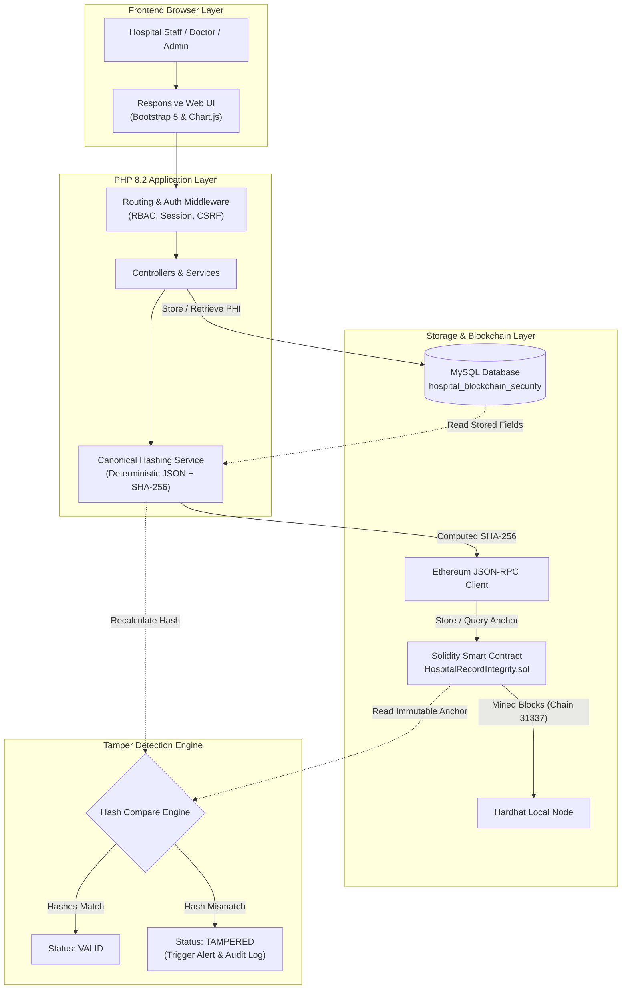
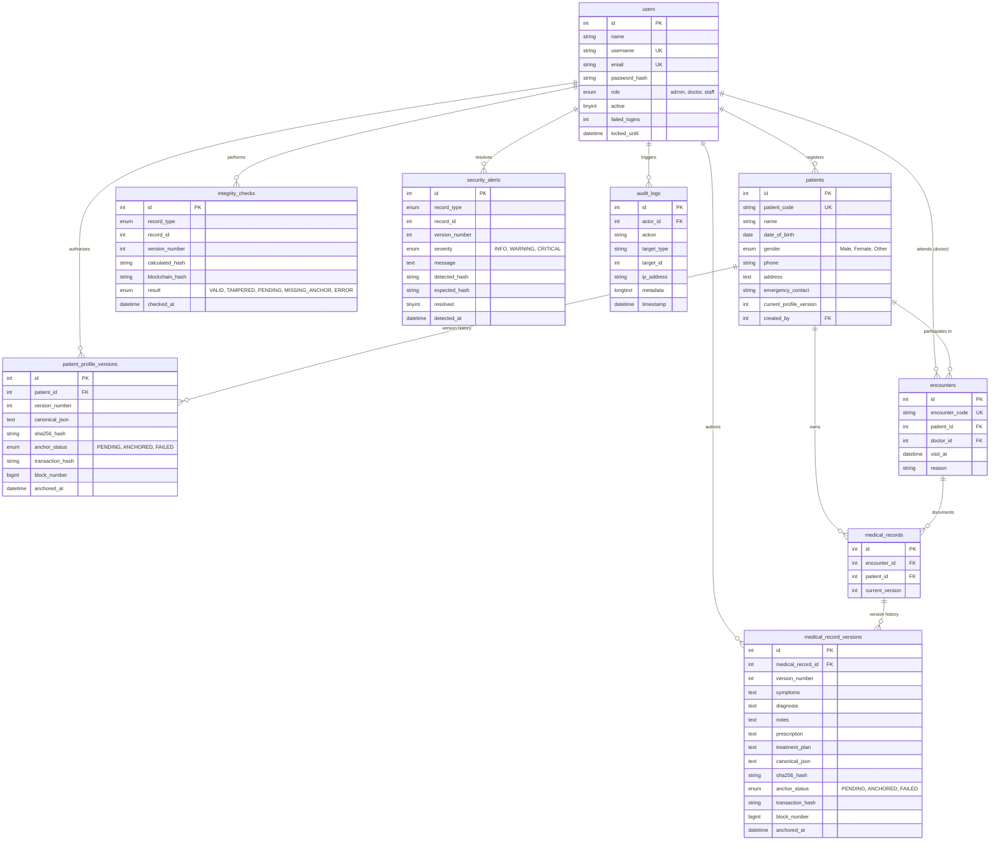

# Hospital Patient Data Security and Tamper Detection Using Blockchain

**An Academic Full-Stack Healthcare Integrity & Cybersecurity Project**

---

## 1. Executive Summary & Objective

In modern Electronic Health Record (EHR) and Hospital Information Systems (HIS), patient records are susceptible to silent, unauthorized data alterations—whether from malicious insiders, compromised credentials, or database administrators bypassing application-level controls. Traditional relational databases alone cannot mathematically guarantee that historical medical records remain unmodified.

This project, **Hospital Patient Data Security and Tamper Detection Using Blockchain**, implements a hybrid database-blockchain integrity architecture:
1. **Sensitive Patient Health Information (PHI) & Clinical Details** are stored locally in a relational MySQL database (`hospital_blockchain_security`) hosted on XAMPP. No confidential patient data (such as names, diagnoses, or prescriptions) is ever placed on the public or private blockchain ledger.
2. **Cryptographic Integrity Commitments** are computed in PHP 8.2+ using deterministic canonical JSON serialization and SHA-256 hashing over protected record versions.
3. **Immutable Anchor Proofs** are permanently recorded onto an Ethereum-compatible local blockchain using a Solidity smart contract (`HospitalRecordIntegrity.sol`).
4. **Active Tamper Detection**: When a record is viewed or audited, its SHA-256 hash is recalculated on the fly from the database row and compared against the immutable on-chain anchor. If any field was altered out-of-band in MySQL, the system immediately flags the state as `TAMPERED`, alerts security administrators, and logs the incident.
5. **Authorized Versioning Workflow**: Legitimate doctor or staff revisions never overwrite existing hashes. Instead, authorized changes increment the version counter to $N+1$, anchor the new version on-chain, and preserve the complete immutable history.

---

## 2. Technology Stack

| Layer | Technology | Details |
|---|---|---|
| **Frontend** | HTML5, CSS3, JavaScript (ES6+), Bootstrap 5.3, Bootstrap Icons, Chart.js 4.4 | Calm clinical theme with cybersecurity monospace elements and real-time status pills. |
| **Backend** | PHP 8.2.4 (CLI & Apache mod_php) | Clean service-oriented architecture, PDO with prepared statements, strict typing, session management, CSRF tokens. |
| **Database** | MySQL / MariaDB 10.4.28 (XAMPP) | Database `hospital_blockchain_security`, 9 relational tables, foreign key constraints, indexes. |
| **Blockchain** | Solidity `^0.8.20`, Hardhat 2.22.18, EVM | Append-only smart contract anchoring `(recordType, recordId, version, bytes32 hash)`. |
| **PHP-to-Chain** | Pure PHP JSON-RPC Client (`eth_call`, `eth_sendTransaction`) | Direct RPC communication to unlocked local Hardhat development node; optional CLI bridge helper. |
| **Web Server** | Apache 2.4.56 via XAMPP | Served on localhost port 80. |

---

## 3. System Architecture & Information Flow



### Off-Chain Storage vs. On-Chain Anchoring Rationale
- **Confidentiality (HIPAA / GDPR Compliance)**: Placing patient demographics, symptoms, or diagnoses directly on a blockchain violates privacy regulations because blockchain records cannot be erased. By storing all actual data in MySQL and storing only opaque `(recordType, recordId, version, bytes32 hash)` on-chain, patient privacy is preserved while retaining tamper-evidence.
- **Cost and Scalability**: Storing large text records on an EVM blockchain incurs high gas fees. Storing a single 32-byte hash per version is cost-efficient and scalable.

---

## 4. Database Design & Entity Relationship

The database `hospital_blockchain_security` consists of 9 normalized tables:



---

## 5. Cryptographic Hashing Specification

To achieve deterministic SHA-256 output, records are canonicalized before hashing:

### Canonical Schema (`v1.0`)
```json
{
  "fields": {
    "diagnosis": "Type 2 Diabetes Mellitus with Mild Hypertension",
    "doctor_id": 2,
    "encounter_id": 1,
    "notes": "Fasting blood sugar 168 mg/dL. BP 138/88 mmHg.",
    "patient_id": 1,
    "prescription": "Metformin 500mg BD after meals; Telmisartan 40mg OD morning.",
    "symptoms": "Fatigue, excessive thirst, blurred vision",
    "treatment_plan": "Review after 4 weeks with HbA1c test and daily glucose log."
  },
  "record_id": 1,
  "record_type": "MEDICAL_RECORD",
  "schema_version": "1.0",
  "version_number": 1
}
```

### Deterministic Rules:
1. **Field Sorting**: All field dictionary keys are sorted alphabetically in ascending ASCII order (`ksort(..., SORT_STRING)`).
2. **Whitespace & Newlines**: String fields are trimmed of leading/trailing spaces. Windows CRLF (`\r\n`) and Mac CR (`\r`) line breaks are converted to uniform LF (`\n`).
3. **Null & Types**: Nulls are serialized as JSON `null`. Integers and floats retain standard numeric representations.
4. **Encoding**: Serialized using `JSON_UNESCAPED_SLASHES | JSON_UNESCAPED_UNICODE`.
5. **Avalanche Effect**: Altering even a single punctuation mark, space, or letter produces an entirely different 256-bit hash.
6. **Ethereum Format**: Hashes are formatted as lowercase 64-character hexadecimal strings prefixed with `0x` (standard Ethereum `bytes32`).

---

## 6. Smart Contract (`HospitalRecordIntegrity.sol`)

The Solidity contract acts as an immutable, append-only key-value ledger:
- **Contract Address (Local)**: `0x8A791620dd6260079BF849Dc5567aDC3F2FdC318`
- **Lookup Key**: `bytes32 recordKey = keccak256(abi.encodePacked(recordType, ":", recordId, ":v", version));`
- **Core Methods**:
  - `storeRecordHash(string recordType, uint256 recordId, uint256 version, bytes32 hash)`: Reverts if already anchored or if hash is zero. Emits `RecordHashStored`.
  - `getRecordHash(string recordType, uint256 recordId, uint256 version) view returns (bytes32, uint256, address, bool)`: Returns anchored hash, block timestamp, anchoring address, and existence flag.
  - `hashExists(string recordType, uint256 recordId, uint256 version) view returns (bool)`: Returns existence boolean.
  - `totalAnchoredRecords() view returns (uint256)`: Returns the total count of on-chain anchored versions.
  - `getRecordAtIndex(uint256 index) view returns (...)`: Enumerates anchored items for the Blockchain Explorer UI.

---

## 7. Role-Based Access Control (RBAC) Matrix

| Module / Action | Admin | Doctor | Staff |
|---|:---:|:---:|:---:|
| **Sign In / Sign Out** | Yes | Yes | Yes |
| **View Dashboard & Metrics** | Yes | Yes | Yes |
| **Register New Patient** | Yes | No | Yes |
| **View Patient Demographic Directory** | Yes | Yes | Yes |
| **Authorized Demographic Amendment** | Yes | No | Yes |
| **Create Clinical Encounter & Medical Record** | Yes | Yes | No |
| **View Clinical Medical Records** | Yes | Yes | Yes |
| **Authorized Clinical Record Amendment** | Yes | Yes | No |
| **Run Single Record Cryptographic Verification** | Yes | Yes | Yes |
| **Run Bulk System-Wide Verification Audit** | Yes | Yes | Yes |
| **Browse Blockchain Ledger Explorer** | Yes | Yes | Yes |
| **View Security Alerts & Audit Trails** | Yes | Yes | Yes |
| **Resolve Security Alerts** | Yes | No | No |
| **Access Controlled Tampering Demonstration Lab** | Yes | No | No |
| **Reset Demonstration Fixtures** | Yes | No | No |

### Pre-Seeded Demonstration Accounts (Local Testing Only):
- **Admin**: `admin@hospital.local` / `Admin@12345`
- **Doctor**: `dr.sharma@hospital.local` / `Doctor@12345`
- **Staff**: `staff.priya@hospital.local` / `Staff@12345`

---

## 8. REST API Reference

All API endpoints return standard `Content-Type: application/json`. State-changing POST requests require authentication and a valid CSRF token header (`X-CSRF-Token`) or parameter (`csrf_token`).

| Endpoint | Method | Role | Description |
|---|---|---|---|
| `/public/api/health.php` | `GET` | Public | System uptime, MySQL connection status, and live blockchain status. |
| `/public/api/auth/login.php` | `POST` | Public | Authenticates credentials, initiates session, returns CSRF token. |
| `/public/api/auth/logout.php` | `POST` | Auth | Destroys session and invalidates cookies. |
| `/public/api/auth/me.php` | `GET` | Auth | Returns authenticated user profile and active CSRF token. |
| `/public/api/patients/index.php` | `GET` | Auth | Paginated patient demographic directory with search filter. |
| `/public/api/patients/create.php` | `POST` | Admin, Staff | Registers patient, creates v1, and anchors hash on-chain. |
| `/public/api/patients/show.php?id=1` | `GET` | Auth | Patient profile, demographic version ledger, and encounters. |
| `/public/api/patients/update.php` | `POST` | Admin, Staff | Authorized amendment: creates version $N+1$ and anchors on-chain. |
| `/public/api/records/index.php` | `GET` | Auth | Directory of clinical records with current diagnosis and anchor status. |
| `/public/api/records/create.php` | `POST` | Admin, Doctor | Creates clinical record, writes v1, and anchors hash on-chain. |
| `/public/api/records/show.php?id=1` | `GET` | Auth | Clinical findings, prescriptions, and version history. |
| `/public/api/records/amend.php` | `POST` | Admin, Doctor | Authorized amendment: creates clinical version $N+1$ and anchors. |
| `/public/api/verification/check.php` | `GET` | Auth | Verifies record (`?type=MEDICAL_RECORD&id=1&version=1`). |
| `/public/api/verification/check-all.php`| `POST` | Auth | Bulk audits all records against blockchain anchors. |
| `/public/api/dashboard/stats.php` | `GET` | Auth | Dashboard metrics, KPI counters, and Chart.js audit datasets. |
| `/public/api/alerts/index.php` | `GET` | Auth | Retrieves security alerts with severity and detected vs expected hashes. |
| `/public/api/alerts/resolve.php` | `POST` | Admin | Resolves an active security alert. |
| `/public/api/audit/index.php` | `GET` | Admin | Retrieves system audit logs. |
| `/public/api/blockchain/status.php` | `GET` | Auth | Queries contract address, block number, and on-chain records. |
| `/public/api/demo/tamper.php` | `POST` | Admin (Local) | Injects out-of-band edit into MySQL without updating blockchain. |
| `/public/api/demo/reset.php` | `POST` | Admin (Local) | Restores baseline test fixtures and re-verifies valid state. |

---

## 9. Verification State Machine

```
              ┌────────────────────────────┐
              │  Record Version in MySQL   │
              └──────────────┬─────────────┘
                             │
                  Anchor to Blockchain
                             ▼
                    ┌─────────────────┐
                    │  PENDING State  │
                    └────────┬────────┘
                             │
               Mined in EVM Block Receipt
                             ▼
                    ┌─────────────────┐
                    │ ANCHORED State  │
                    └────────┬────────┘
                             │
                    Integrity Audit
                             ▼
               ┌───────────────────────────┐
               │ Compare Calculated SHA-256│
               │   vs Blockchain Anchor    │
               └─────────────┬─────────────┘
                             │
              ┌──────────────┴──────────────┐
              ▼                             ▼
       [Hashes Match]              [Hashes Mismatch]
              ▼                             ▼
     ┌─────────────────┐           ┌─────────────────┐
     │  VALID Status   │           │ TAMPERED Status │
     └─────────────────┘           └────────┬────────┘
                                            │
                                            ▼
                                  ┌──────────────────┐
                                  │ Security Alert & │
                                  │ Audit Log Fired  │
                                  └──────────────────┘
```

---

## 10. Exact Local Run & Setup Instructions

### Prerequisites
1. **XAMPP** installed on macOS, Windows, or Linux (providing Apache 2.4 and MySQL/MariaDB with PHP 8.2+).
2. **Node.js** (v18+ or v20+) and **npm** installed (used solely for Hardhat local blockchain tooling).

### Step 1: Start XAMPP Apache and MySQL
- Open the XAMPP Control Panel and start **Apache** and **MySQL**.
- Ensure the project repository is located inside your XAMPP web root:
  - macOS: `/Applications/XAMPP/xamppfiles/htdocs/Hospital Tamper Detection`
  - Windows: `C:\xampp\htdocs\Hospital Tamper Detection`
  - Linux: `/opt/lampp/htdocs/Hospital Tamper Detection`

### Step 2: Initialize Database and Schema
Import the database schema and sample seed data using phpMyAdmin (`http://localhost/phpmyadmin`) or the MySQL CLI:
```bash
# macOS XAMPP CLI:
/Applications/XAMPP/xamppfiles/bin/mysql -u root < database/schema.sql
/Applications/XAMPP/xamppfiles/bin/mysql -u root < database/seed.sql

# Windows XAMPP CLI:
C:\xampp\mysql\bin\mysql.exe -u root < database/schema.sql
C:\xampp\mysql\bin\mysql.exe -u root < database/seed.sql
```

### Step 3: Install Blockchain Tooling
Open a terminal in the project directory:
```bash
cd blockchain
npm install
```

### Step 4: Launch Local Blockchain Node
Start the local Ethereum development node (Hardhat):
```bash
# In the blockchain/ directory:
npx hardhat node
```
*Leave this terminal window open. The node will listen at `http://127.0.0.1:8545` and provide pre-funded development accounts.*

### Step 5: Compile & Deploy the Smart Contract
Open a second terminal window in the project directory:
```bash
cd blockchain
npx hardhat compile
npx hardhat run scripts/deploy.js --network localhost
```
*This command automatically compiles `HospitalRecordIntegrity.sol`, deploys it to the local node, and saves the contract address to `blockchain/deployed-contract.json`, `app/config/contract.json`, and `.env`.*

### Step 6: Anchor Initial Demonstration Records
Populate baseline cryptographic hashes on the blockchain:
```bash
# From project root:
php database/seed_anchors.php
# Or on macOS XAMPP:
/Applications/XAMPP/xamppfiles/bin/php database/seed_anchors.php
```

### Step 7: Open the Application in Your Browser
Navigate to:
```
http://localhost/Hospital%20Tamper%20Detection/
```
*(The root entrypoint automatically directs to `/public/index.php?page=login`).*

---

## 11. Automated Test Suite Execution

Run the comprehensive automated test suite (37 assertions covering hashing, EVM contract storage, duplicate prevention, verification, tampering detection, and authorized amendments):
```bash
# From project root:
/Applications/XAMPP/xamppfiles/bin/php tests/run_tests.php
```
Sample test output:
```
======================================================================
 Hospital Patient Data Security and Tamper Detection - Test Suite
 Academic Project Verification and Test Report
======================================================================

=== Running Canonical Hashing & Test Vector Suite ===
  [PASS] Different input key orders produce identical canonical JSON
  [PASS] CRLF line endings and trailing whitespace normalize to identical SHA-256
  [PASS] Null values serialize strictly as JSON null
  [PASS] Generated SHA-256 matches independent PHP hash('sha256')
  [PASS] Hash is formatted as 66-character bytes32 (0x + 64 hex)
  [PASS] verifyHash is case-insensitive
  [PASS] verifyHash rejects mismatching hash
  [PASS] Single character edit produces completely distinct avalanche hash proof

=== Running Blockchain & Smart Contract Suite ===
  [PASS] Local Ethereum node connection active at http://127.0.0.1:8545
  [PASS] HospitalRecordIntegrity contract deployed at 0x8A79...
  [PASS] Current EVM block height is #22
  [PASS] Transaction confirmed with hash 0x9bdd...
  [PASS] Mined in block #23
  [PASS] hashExists confirms record is anchored on blockchain
  [PASS] On-chain hash exactly matches stored SHA-256
  [PASS] Contract reverts on duplicate anchor attempt for same (recordType, id, version)
  [PASS] Contract reverts on zero bytes32 hash attempt

=== Running Integrity Verification & Tamper Detection Suite ===
  [PASS] Patient #1 (v1) verifies as VALID against on-chain anchor
  [PASS] Medical Record #1 (v1) verifies as VALID against on-chain anchor
  [PASS] Direct database modification was detected as TAMPERED
  [PASS] Calculated hash does not match immutable on-chain anchor
  [PASS] Security alert automatically registered in security_alerts table
  [PASS] Restoring original database content returns status to VALID

=== Running Patient & Clinical Record Lifecycle Suite ===
  [PASS] Patient PAT-TEST created with ID #5
  [PASS] Initial profile version set to 1
  [PASS] Patient #5 v1 verified as VALID on blockchain
  [PASS] Record #5 (v1) verified as VALID on blockchain
  [PASS] Authorized amendment created Version 2
  [PASS] Historical Version 1 remains VALID and un-overwritten on chain
  [PASS] Amended Version 2 is independently anchored and VALID on chain
  [PASS] v1 and v2 have distinct immutable cryptographic hash proofs

======================================================================
 FINAL TEST REPORT
 Total Assertions Passed: 37
 Total Assertions Failed: 0
 Overall Status: ALL TESTS PASSED [SUCCESS]
======================================================================
```

---

## 12. Step-by-Step Academic Defense Demonstration

Follow this exact script when presenting or demonstrating this project for academic evaluation:

### Step 1: Authentication & Role Differentiation
1. Open `http://localhost/Hospital%20Tamper%20Detection/`.
2. Click the quick-fill button **Admin (Dr. Alok Verma)** and log in.
3. Observe the top navbar:
   - Green pill: `● Hardhat Node: Block #XX` showing active EVM connection.
   - User dropdown indicating `admin` role badge.

### Step 2: Observe Baseline Valid State
1. Click **Integrity Verification** in the top navigation.
2. Select **Clinical Medical Record**, Record ID `1`, Version `1`. Click **Verify Against Blockchain**.
3. A modal opens with a green shield:
   - Result: `VALID`
   - Database Computed Hash: matches the Blockchain Anchored Hash bit-for-bit.
   - Comparison Outcome: `Bitwise Match (Deterministic SHA-256 Identical)`.
   - Displays real transaction ID and block height.

### Step 3: Conduct the Out-of-Band Tamper Attack
1. Click **Tampering Lab** in the top navigation bar.
2. Under **Clinical Record Tampering Test Bed**:
   - Target: `Record #1 (Rajesh Kumar) - Current v1`
   - Target SQL Column: `diagnosis`
   - Malicious Value: `Acute Appendicitis with Peritonitis (Injected via rogue SQL)`
   - Click **2. Inject Tamper into MySQL**.
3. A confirmation card appears indicating the SQL row has been modified in MySQL without interacting with the blockchain.

### Step 4: Detect the Tamper Violation
1. In the Tampering Lab card, click **Verify Now & Observe TAMPERED Alert** (or go to **Integrity Verification** and verify Record 1 v1).
2. The modal appears with a red shield:
   - Result: `TAMPERED`
   - Database Computed Hash: displays the newly recalculated SHA-256 over the rogue diagnosis.
   - Blockchain Anchored Hash: displays the original immutable hash stored at block creation.
   - Outcome: `Cryptographic Hash Mismatch! Database row has been modified out-of-band.`
3. Notice the red bell icon in the navbar now displays an active alert badge `1`.
4. Click **Security Alerts**:
   - A critical security alert is displayed detailing the incident, detection timestamp, detected hash vs expected hash.

### Step 5: Demonstrate Authorized Clinical Amendment ($v1 \to v2$)
1. Navigate to **Medical Records** and click the eye icon for **Record #1**.
2. Click **Authorized Amendment**.
3. Note the academic explanation box: *Submitting an authorized revision creates Version 2 and securely anchors its hash, preserving Version 1.*
4. Update the clinical notes or prescription and click **Authorize & Anchor Version 2**.
5. Observe the Version Ledger:
   - Version 2 is created and anchored in a new Ethereum block.
   - Click **Verify** on Version 2: returns `VALID`.
   - The system distinguishes legitimate authorized revisions from illicit out-of-band tampering.

### Step 6: Reset Demonstration Fixtures
1. Return to the **Tampering Lab**.
2. Click **Reset Fictional Fixtures**.
3. All baseline clinical diagnoses are restored to their pristine seed state and outstanding alerts are resolved.

---

## 13. Security Limitations & Academic Analysis

For academic rigor, the following theoretical and practical boundaries of this architecture must be understood:

1. **Detection vs. Prevention**: Blockchain hash anchoring provides **tamper evidence**, not tamper prevention. An attacker with direct MySQL access can still corrupt the local database. However, the alteration cannot be hidden or repudiated because the blockchain anchor remains immutable.
2. **Confidentiality vs. Integrity**: Blockchain ensures integrity and proof of existence, not data secrecy. Placing medical text directly on-chain would violate patient confidentiality. Keeping data in MySQL preserves confidentiality while blockchain anchors provide integrity verification.
3. **Attribution Limitations**: When a hash mismatch is detected, the system proves mathematically that the stored data differs from its anchored state. The hash comparison alone cannot prove *who* executed the database change; attributing the actor relies on secure database audit logs and server access controls.
4. **Local Blockchain Persistence**: In this local academic implementation, the Hardhat development chain stores blocks in memory. Restarting the Hardhat node resets the block height to zero. In production deployment, the contract would be deployed to an enterprise private/consortium EVM network (e.g. Hyperledger Besu or Polygon Supernets) with persistent disk storage across distributed validator nodes.
